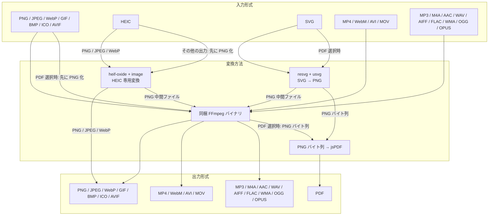
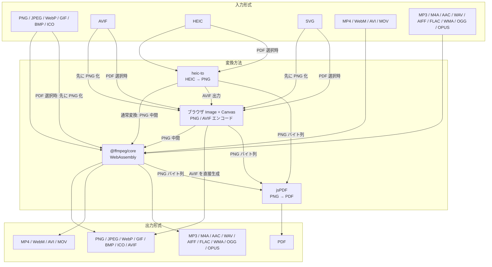

# 変換はかせ

あらゆるファイル操作を一括でできるアプリケーション。

## 使用技術, ドキュメント

- フロントエンド: [React](https://ja.react.dev/learn), [TypeScript](https://typescriptbook.jp/), [TailwindCSS](https://tailwindcss.com/docs/installation/using-vite)
- バックエンド: [Rust](https://doc.rust-jp.rs/book-ja/)
- フレームワーク: [Tauri](https://v2.tauri.app/ja/develop/)
- ツール: [FFmpeg](https://ffmpeg.org/)

## 変換の流れ

### デスクトップ版


### ブラウザ版



## ディレクトリ構成

### 追跡ディレクトリ

| パス                        | 内容                                                          |
| --------------------------- | ------------------------------------------------------------- |
| `public`                    | ビルド後にルートに置かれる。画像など                          |
| `scripts/build-ffmpeg.sh`   | 同梱するFFmpeg(GPL版・LGPL版)のビルドスクリプト               |
| `src/assets`              | 画像など。importして使える                                            |
| `src/components`            | Reactのコンポーネント                                          |
| `src/utils/browser-ffmpeg-browser.ts` | `@ffmpeg/core` WASMの読み込み、ブラウザ上の調査・変換 |
| `src/utils/browser-ffmpeg-desktop.ts` | デスクトップ版でブラウザ用WASMを誤って呼ばないための代替処理 |
| `src/utils/dimension.ts`    | 画像や動画のサイズの正規化                                       |
| `src/utils/error.ts`        | Tauriから返されたエラーコードを画面表示用の文章へ変換           |
| `src/utils/ffmpeg-command.ts` | サイズ調査・サムネイル作成用のFFmpeg引数とPNGサイズ解析       |
| `src/utils/ffmpeg.ts`       | ブラウザ版FFmpegに渡す変換指示の組み立て                         |
| `src/utils/path.ts`         | ファイルパスから拡張子と入力形式を判定                           |
| `src/App.css`               | スタイルシート                                                |
| `src/formats.ts`             | 変換可能なファイル形式、拡張子、MIME typeの定義                 |
| `src/license-links.ts`        | ライセンスページの生成                          |
| `src/App.tsx`               | フロントエンドの本体                                          |
| `src/i18n.tsx`                | 多言語対応の設定                                              |
| `src-tauri/icons`           | アプリケーションアイコン                                      |
| `src-tauri/licenses`        | 依存ライブラリのライセンス一覧。インストーラーに同梱される    |
| `src-tauri/src/conversion/error.rs` | 変換処理におけるエラーの定義                            |
| `src-tauri/src/conversion/ffmpeg.rs` | FFmpegのコマンドの組み立て                            |
| `src-tauri/src/conversion/mod.rs`    | 変換処理のモジュール                                          |
| `src-tauri/src/conversion/progress.rs`    | 変換処理の進行状況                                |
| `src-tauri/src/conversion/types.rs`  | 変換処理の型定義                                      |
| `src-tauri/src/lib.rs`      | 変換処理の呼び出し                                            |
| `src-tauri/.gitignore`      | Gitで管理しないファイルの設定(バックエンド)                   |
| `src-tauri/about.hbs` | Rustで使用している依存ライブラリのライセンス一覧を表示するためのテンプレート |
| `src-tauri/tauri.conf.json` | Tauriの設定ファイル                                           |
| `src-tauri/tauri.windows.conf.json` | TauriのWindows版の設定ファイル(Windows版にだけ同梱するライセンス表記) |
| `src-tauri/tauri.lgpl.conf.json` | TauriのLGPL版の設定ファイル(同梱するバイナリをLGPL版に上書き)                  |
| `src-tauri/build.rs` | Tauriのビルドスクリプト。LGPL版の場合に同梱バイナリがLGPLかどうかを確認する |
| `src-tauri/about.toml`      | Rustのライセンス依存情報                                   |
| `src-tauri/Cargo.toml`      | Rustの設定ファイル                                            |
| `.gitignore`                | Gitで管理しないファイルの設定                                 |
| `package-lock.json`         | npmの依存パッケージのバージョンを固定するためのファイル       |
| `package.json`              | npmの設定ファイル                                             |
| `LICENSE`                   | ライセンス(MIT)                                               |
| `README.md`                 | この文章                                                      |

### ブラウザ版とデスクトップ版の変換処理の対応

ブラウザ版とデスクトップ版は、同じUIから呼び出されますが、入力データの
渡し方とFFmpegの実行場所が異なります。

- **ブラウザ版**: `File`の内容を`@ffmpeg/core`のWASM仮想ファイルシステムへ
  書き込み、ブラウザ内でFFmpegを実行します。サーバーへのアップロードは行いません。
- **デスクトップ版**: TauriのRustコマンドへ入力ファイルのパスを渡し、Rustが
  同梱FFmpegのsidecarを起動します。ファイル本体のバイト列をTypeScriptから
  Rustへ渡す方式ではありません。

#### 変換処理の対応

| 処理 | ブラウザ版 | デスクトップ版 |
| --- | --- | --- |
| UIからの分岐 | `App.tsx`で`isTauri()`が`false`の場合に`convertBrowserFile`を呼ぶ | `App.tsx`で`isTauri()`が`true`の場合に`invoke("convert_file")`を呼ぶ |
| 入力 | `File.arrayBuffer()`で取得したバイト列 | `ConversionRequest.input_path`のファイルパス |
| FFmpegの準備 | `loadBrowserFfmpeg`で`@ffmpeg/core`の`ffmpeg-core.js`とWASMをロード | `src-tauri/binaries`または`src-tauri/binaries-lgpl`のsidecarを使用 |
| FFmpeg引数の組み立て | `src/utils/ffmpeg.ts`の`buildArgs` | `src-tauri/src/conversion/ffmpeg.rs`の`build_args` |
| 実行 | `FFmpeg.writeFile` → `FFmpeg.exec` → `FFmpeg.readFile` | `conversion::convert` → `sidecar("ffmpeg").args(...).spawn()` |
| 出力 | WASM仮想ファイルから読み出したバイト列を`Blob`にし、Object URLを作成 | 一時ディレクトリに出力し、生成されたファイルパスを返す |
| 後始末 | `finally`で入力・出力の仮想ファイルを削除 | `TempFile`が失敗・キャンセル時の一時出力を削除 |
| キャンセル | `FFmpeg.terminate()`でWASM実行を終了 | sidecarのchild processをkill |
| 進捗 | 現在は変換完了後に結果を返す | FFmpegの`-progress pipe:1`の出力を読み、Tauriイベントで通知 |

ただし、実行環境に固有の差があります。デスクトップ版のRust実装には、
FFmpegの進捗引数、一時ファイル管理、入力オプションの検証、HEIC専用処理、
複数サイズICO、LGPL版での`h264_videotoolbox`への切り替えがあります。
ブラウザ版はWASMのFFmpegが利用できるコーデックを前提に実行し、変換結果を
メモリ上の`Blob`として扱います。

#### メディア情報の取得とサムネイル

変換前の幅・高さの取得は、変換処理とは別の経路です。

| 処理 | ブラウザ版 | デスクトップ版 |
| --- | --- | --- |
| 画像のサイズ | `browser-ffmpeg-browser.ts`の`probeDimensions`が`Image` APIで取得 | `conversion/mod.rs`の`probe_dimensions`がFFmpegでPNGを生成し、`parse_png_dimensions`で解析 |
| 動画のサイズ | `probeDimensions`が`video`要素のメタデータから取得 | `probe_dimensions`がFFmpegでPNGを生成し、PNGのIHDRから解析 |
| GIF・動画のサムネイル | `generateThumbnail`が動画を`video`要素とCanvasからJPEGとして生成 | `generate_thumbnail`が`ffmpeg-command.ts`と同じ形式の引数で生成 |
| HEIC | WASM側のFFmpegによる変換経路 | `conversion/heic.rs`の`heif-oxide`と`image`による専用処理 |

`src/utils/ffmpeg-command.ts`には、デスクトップ側のプローブ・サムネイル処理と
対応するFFmpeg引数、およびPNGサイズ解析のロジックがあります。変換本体の
引数は`ffmpeg.ts`、デスクトップ版の変換本体は`ffmpeg.rs`が担当します。

デスクトップビルドで`browser-ffmpeg-browser.ts`を誤って使用しないよう、
`browser-ffmpeg-desktop.ts`はブラウザ用WASM処理の代わりに明示的なエラーを
返します。新しい形式や設定を追加するときは、`ffmpeg.ts`と`ffmpeg.rs`の
両方に加え、GPL版・LGPL版・ブラウザ版それぞれのFFmpegで利用可能かを確認
してください。

### 非追跡ディレクトリ

| パス                        | 内容                                                          |
| --------------------------- | ------------------------------------------------------------- |
| `dist`                      | ビルド成果物の出力先ディレクトリ。`npm run build`で生成される |
| `dist-web`                   | ブラウザ版のビルド成果物の出力先ディレクトリ。`npm run build:web`で生成される |
| `node_modules`              | npmの依存パッケージ。`npm install`で生成される                |
| `src-tauri/binaries`        | FFmpegのバイナリファイル。sidecarで使用されている             |
| `src-tauri/binaries-lgpl`   | Mac App Store 向けの LGPL 版 FFmpeg のバイナリファイル         |
| `src-tauri/target/release/bundle` | Tauriのビルド成果物の出力先ディレクトリ。`npm run tauri build`で生成される |

## インストール

### Windowsの場合

1. [Microsoft C++ Build Tools](https://visualstudio.microsoft.com/ja/visual-cpp-build-tools/)をインストール

2. Rustのインストール

   ```bash
   winget install --id Rustlang.Rustup
   ```

### MacOSの場合

1. Rustのインストール

   ```bash
   curl --proto '=https' --tlsv1.2 -sSf https://sh.rustup.rs | sh
   echo 'export PATH="$HOME/.cargo/bin:$PATH"' >> ~/.zshrc
   ```

2. Homebrewのインストール

   ```bash
   /bin/bash -c "$(curl -fsSL https://raw.githubusercontent.com/Homebrew/install/HEAD/install.sh)"
   echo 'eval $(/opt/homebrew/bin/brew shellenv)' >> ~/.zprofile
   eval $(/opt/homebrew/bin/brew shellenv)
   source ~/.zshrc
   ```

## FFmpegのバイナリファイルの設置

アプリに同梱する FFmpeg は `scripts/build-ffmpeg.sh` でビルドします。必要なライブラリだけを静的リンクし、配布時にリリースへ添付する対応ソースコード一式も出力します。

| 同梱先                      | コマンド                              | ビルドする環境                  |
| --------------------------- | ------------------------------------- | ------------------------------- |
| Linux                       | `scripts/build-ffmpeg.sh gpl`         | Linux(WSL を含む)             |
| Windows                     | `scripts/build-ffmpeg.sh gpl windows` | Linux(WSL を含む)からクロスコンパイル |
| macOS(Intel / Apple Silicon) | `scripts/build-ffmpeg.sh gpl`         | 同じアーキテクチャの Mac        |
| Mac App Store               | `scripts/build-ffmpeg.sh lgpl`        | 同じアーキテクチャの Mac        |

事前に必要なツールをインストールしてください。

```bash
# Linux / WSL(Windows 向けもビルドする場合は mingw-w64 も)
sudo apt install build-essential pkg-config cmake nasm curl mingw-w64

# macOS
xcode-select --install
brew install pkg-config cmake nasm
```

- バイナリは `src-tauri/binaries`(LGPL 版は `src-tauri/binaries-lgpl`)に、Tauri の sidecar の名前(`henkanhakase-ffmpeg-x86_64-unknown-linux-gnu` など)で出力されます。Linux の `.deb` では `/usr/bin` に置かれるため、ディストリビューションの `ffmpeg` とぶつからないよう `henkanhakase-` を付けています
- 初回は依存ライブラリのビルドに数十分かかります。2 回目以降はビルド済みのライブラリをスキップします
- Linux 版はビルドした環境の glibc に依存します。アプリ本体と同じく、対応したい中で最も古いディストリビューションでビルドしてください
- バージョンや設定はスクリプト冒頭のコメントを参照してください

## 開発

- 依存パッケージのインストール(`package.json`が更新されたときに実行)

  ```bash
  npm install
  ```

- 新たなパッケージのインストール

  ```bash
  npm install <パッケージ名>
  ```

- tauriのプラグインのインストール

  ```bash
  npm run tauri add <プラグイン名>
  ```

- 開発環境でアプリケーションを起動(`ctrl + C` / `⌃C`で終了)

  ```bash
  npm run tauri dev
  ```

- アプリケーションをビルド
  - GPL版の場合
   ```bash
   npm run tauri build
   ```
- LGPL版の場合
   ```bash
   npm run tauri:build:lgpl
   ```

- ブラウザ版をビルド

  ```bash
  npm run build:web
  ```

  ブラウザ版は `dist-web` に出力され、`@ffmpeg/core` の WebAssembly
  ファイルを使用します。通常の `npm run build` および Tauri のビルドは
  `dist` に出力され、ブラウザ版の FFmpeg は含まれません。

  ビルドしたブラウザ版を試すには、以下を実行します。

  ```bash
  npx vite preview --port 3000 --outDir dist-web
  ```

- FFmpegのインストール(バイナリファイルを設置するため、インストールしなくてもアプリケーションは動作する)
  - Windowsの場合

  ```bash
  winget install -e --id Gyan.FFmpeg
  ```

  - MacOSの場合

  ```bash
  brew install ffmpeg-full
  ```

- FFmpegでファイル形式を変換する例(プロジェクトのルートに`input.jpg`を置く)
  ```bash
  ffmpeg -i input.jpg output.png
  ```

## ライセンス

本体のソースコードは [MIT License](LICENSE) で公開しています。

ただし、アプリケーションに同梱している [FFmpeg](https://ffmpeg.org/) のバイナリ(`src-tauri/binaries`)は本体とは別のプログラムで、それぞれのビルドのライセンスに従います。

| 配布先                                    | 同梱する FFmpeg                       | ビルド方法                 |
| ----------------------------------------- | ------------------------------------- | -------------------------- |
| GitHub(Windows / Linux / macOS)、Microsoft Store | GPL 版(GPL-2.0-or-later、`src-tauri/binaries`) | `npm run tauri build`      |
| Mac App Store                             | LGPL 版(LGPL-2.1-or-later、`src-tauri/binaries-lgpl`) | `npm run tauri:build:lgpl` |

同梱する FFmpeg は、どちらも `scripts/build-ffmpeg.sh` で同じバージョンのソースからビルドします(`--enable-version3` / `--enable-nonfree` は付けません)。

配布するときは、スクリプトが `~/ffmpeg-build/out` に出力する対応ソースコード一式を GitHub のリリースに添付してください。ソースは全プラットフォームで共通なので、GPL 版(`ffmpeg-gpl-<version>-src.tar.gz`)と LGPL 版(`ffmpeg-lgpl-<version>-src.tar.gz`)をそれぞれ 1 つ添付すれば足ります。ライセンスの本文と説明は `src-tauri/licenses/FFmpeg-*.txt` にあり、インストーラーに同梱されます。

### macOS 向け LGPL 版のビルド

H.264 エンコーダの libx264 は GPL のため、LGPL 版では macOS 標準の VideoToolbox(`h264_videotoolbox`)を使います。`npm run tauri:build:lgpl` は Cargo の `lgpl-ffmpeg` feature を有効にしてエンコーダを切り替え、`src-tauri/tauri.lgpl.conf.json` で同梱する FFmpeg を `src-tauri/binaries-lgpl` のものに差し替えます(macOS でのみビルドできます)。GPL 版と LGPL 版は別のディレクトリに置くので、入れ替える必要はありません。

ビルド時に `src-tauri/build.rs` が、同梱する FFmpeg が LGPL 版であること(`ffmpeg -L` と `-buildconf`)と、feature と設定の組み合わせが正しいことを検証し、問題があればビルドを止めます。

- 画質(CRF)は VideoToolbox の `-q:v` に変換して指定します。Intel Mac では `-q:v` が使えないため、エンコーダの既定のビットレートになります
- `-allow_sw 1` を付けているため、ハードウェアエンコーダが使えない環境ではソフトウェアエンコードになります
- Homebrew などで配布されている `ffmpeg` は GPL 版なので使えません。`scripts/build-ffmpeg.sh lgpl` でビルドしてください
- Mac App Store ではアプリ全体がサンドボックスで動くため、同梱する FFmpeg にも `com.apple.security.app-sandbox` と `com.apple.security.inherit` の entitlements を付けて署名してください

### 依存ライブラリのライセンス一覧

配布物には `src-tauri/licenses` 配下のライセンス一覧を同梱しています。

| ファイル                           | 内容                       | 更新方法                                                    |
| ---------------------------------- | -------------------------- | ----------------------------------------------------------- |
| `THIRD_PARTY_LICENSES_FRONTEND.txt` | フロントエンドのライブラリ | `npm run build` で自動生成(Git 管理外)                    |
| `THIRD_PARTY_LICENSES_RUST.txt`    | Rust のクレート            | `npm run licenses` で生成(リリース前と Rust の依存を変えたとき) |
| `THIRD_PARTY_LICENSES_OTHER.txt`   | Tailwind CSS、アイコンなど | 手動で編集                                                  |
| `FFmpeg-LIBRARIES.txt`             | FFmpeg に静的リンクしたライブラリ | `scripts/build-ffmpeg.sh` で生成(ライブラリのバージョンを変えたとき) |
| `FFmpeg-MinGW-w64.txt`             | Windows 版の FFmpeg に静的リンクした MinGW-w64 のランタイム | 手動で編集(MinGW-w64 のメジャーバージョンを変えたとき) |

`npm run licenses` には [cargo-about](https://github.com/EmbarkStudios/cargo-about) が必要です。

```bash
cargo install --locked cargo-about --features cli
```

許可していないライセンスの依存を追加すると、生成時にエラーになります。問題ないライセンスであれば `vite.config.ts` または `src-tauri/about.toml` の許可リストに追加してください。
